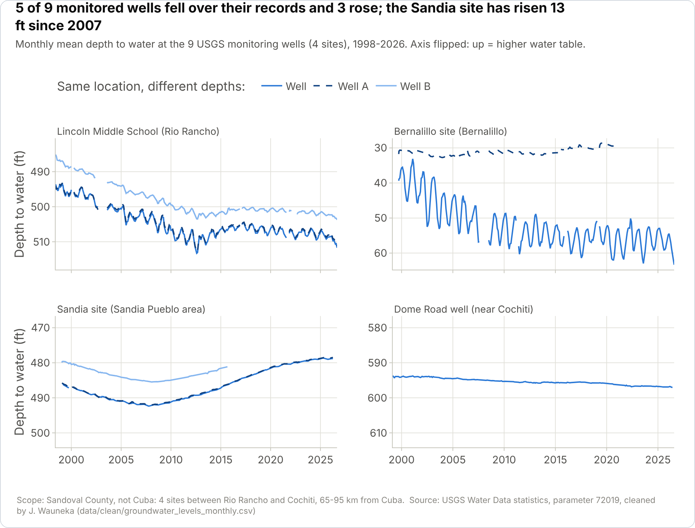
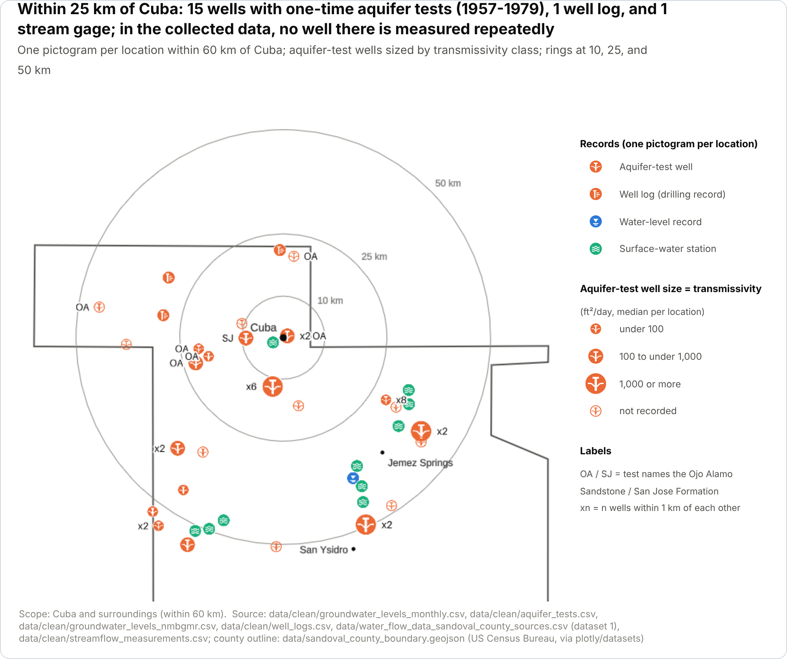
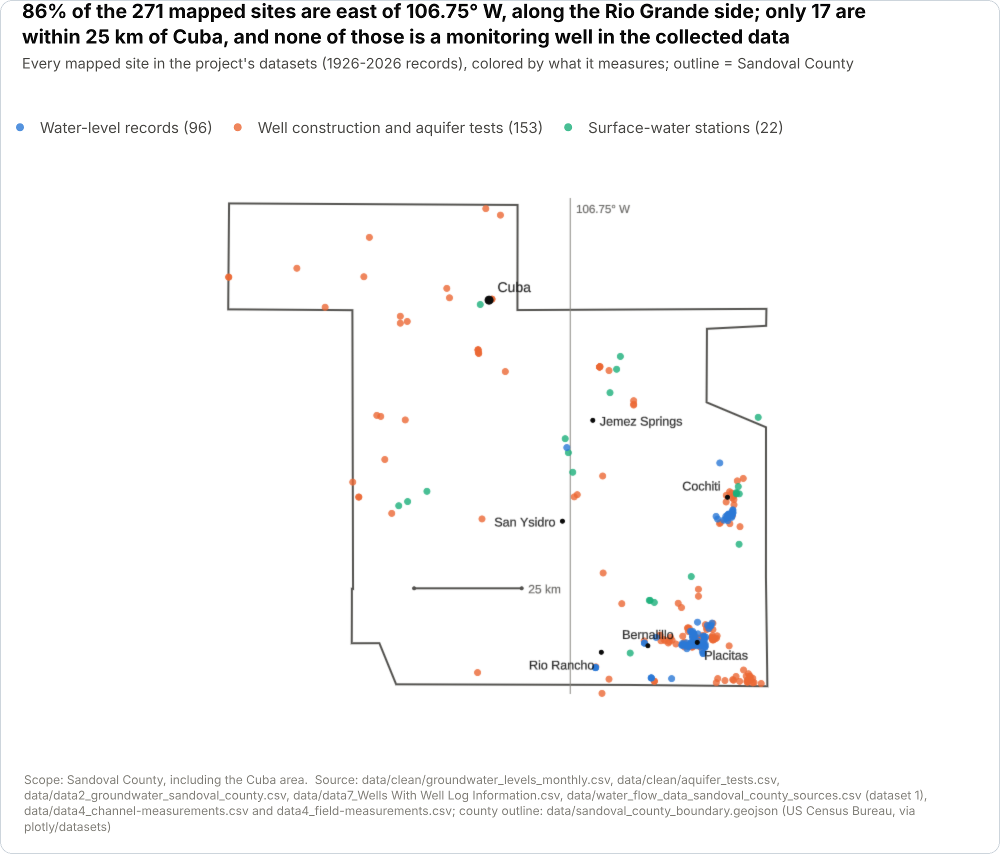

# Beneath the Mesa
### Assessing Aquifer and Well Water Resources Across Sandoval County, New Mexico

**ENG 220 · Team 23 · University of New Mexico · Instructor: Ramiro Jordan**

[](https://eng220aquiferproject.streamlit.app/)
[](https://pdjordj11.github.io/eng_220_aquifer_project/)
[](https://pdjordj11.github.io/eng_220_aquifer_project/files/project_report_draft.pdf)
[](https://pdjordj11.github.io/eng_220_aquifer_project/files/beneath_the_mesa_slides.pdf)

## About the Project

This project uses public groundwater data to assess aquifers and wells across Sandoval County, New Mexico, with the Village of Cuba as a case study. It tests what the available records show about groundwater levels, wells and aquifer units, the Ojo Alamo Sandstone and San Jose Formation near Cuba, and monitoring coverage, and labels every finding as *Measured*, *Hypothesis*, or *Insufficient data*.

The work follows a peace-engineering approach: an open, reproducible analysis that gives residents, the village, and state agencies a shared set of facts about their water. It also makes an equity issue visible: monitoring is concentrated where most people live, while small rural communities such as Cuba, which rely on their own wells, have the least information about their aquifers.

## Research Questions

1. How have groundwater levels changed at monitored wells in Sandoval County, and which wells show sustained decline, stability, or recovery?
2. What do well records show about well depth, depth to water, and the aquifer units that wells in different parts of the county draw from?
3. What do available records show about groundwater near Cuba, and are they enough to evaluate the concern that its main aquifer is approaching severe depletion?
4. How do the Ojo Alamo Sandstone and San Jose Formation compare near Cuba in extent, thickness, and hydraulic properties?
5. Where is monitoring coverage strong, and where are the most important data gaps?
6. Which indicators can be combined into a dashboard that shows groundwater stress without overstating how certain the data are?

## Key Findings

| | Finding | Label |
|---|---|---|
| **1. Groundwater levels** | 5 of the 9 USGS monitoring wells between Rio Rancho and Cochiti fell over their records (1998–2026), and the Lincoln Middle School and Dome Road wells were still falling in 2016–2025. The Sandia site is the exception: its water level has risen about 13 ft since 2007. | Measured |
| **2. Wells and aquifers** | Where water is deeper, wells are drilled deeper. Aquifer properties can vary more within a formation than between formations: transmissivity spans up to 61,000-fold in the Madera Limestone. | Measured |
| **3. Groundwater near Cuba** | Within 25 km of Cuba there are only one-time aquifer tests at 15 wells (1957–1979), one well log, and one stream gage; the nearest well measured more than once is 38 km away. The records can't confirm or rule out depletion of Cuba's aquifer; Cuba's municipal well records are the missing piece. | Insufficient data |
| **4. Ojo Alamo vs San Jose** | Only 8 aquifer-test events (7 Ojo Alamo, 1 San Jose; 1953–1977) name the two formations, too few to compare them. On the USGS map, Cuba sits where the Ojo Alamo Sandstone is shallow. | Insufficient data |
| **5. Monitoring coverage** | 86% of the 271 mapped sites lie east of 106.75° W, along the Rio Grande. Groundwater levels are measured every year at only 4 sites, all in the east of the county. | Measured |
| **6. Stress indicators** | Five indicators, each with where it applies and how much to trust it, are combined on the app's Data sources page. | Measured |

At Cuba itself, the only recent measurements are of the Rio Puerco, which had measurable flow on all 4 visits in April and May and on none of the 6 visits from August to March. The full findings are on the [Findings page](https://pdjordj11.github.io/eng_220_aquifer_project/findings/).

## Results

Three of the project's 15 charts are below. Every chart, with its method, caption, and labeled findings, is on the documentation site's [Analysis page](https://pdjordj11.github.io/eng_220_aquifer_project/analysis/) and in the [live app](https://eng220aquiferproject.streamlit.app/).

**Groundwater levels at the county's monitoring wells (research question 1)**

<picture>
  <source media="(prefers-color-scheme: dark)" srcset=".github/readme/groundwater_hydrographs_dark.png">
  
</picture>

**Records near Cuba (research question 3)**

<picture>
  <source media="(prefers-color-scheme: dark)" srcset=".github/readme/cuba_area_map_dark.png">
  
</picture>

**Where monitoring exists in Sandoval County (research question 5)**

<picture>
  <source media="(prefers-color-scheme: dark)" srcset=".github/readme/county_coverage_map_dark.png">
  
</picture>

## Data

Eight public datasets, described in Dylan Gonzales's [dataset briefs](https://pdjordj11.github.io/eng_220_aquifer_project/data-collection/). The raw files are in [`data/`](data/README.md) and are never edited; cleaned versions are in [`data/clean/`](data/clean/README.md).

| # | Dataset | Source |
|---|---|---|
| 1 | Groundwater-level statistics, 9 monitoring wells | U.S. Geological Survey |
| 2 | Groundwater levels, 87 wells | NM Bureau of Geology and Mineral Resources |
| 3 | Aquifer sensitivity | NM Environment Department |
| 4 | Rio Puerco at Cuba, stream measurements | U.S. Geological Survey |
| 5 | Ojo Alamo Sandstone map atlas | U.S. Geological Survey |
| 6 | San Jose Formation near Lindrith | New Mexico Geological Society |
| 7 | Wells with well logs | NM Office of the State Engineer |
| | Aquifer tests, 179 in Sandoval County | NM Office of the State Engineer |

## Team

| Member | Role |
|---|---|
| Petar Djordjevic (Prime Minister) | Documentation, final report, presentation, and video |
| Dylan Gonzales | Data acquisition and dataset justification |
| James Wauneka | Data cleaning and preprocessing |
| Micah Watkins | Analysis code and visualizations |
| Meckrem Yousef | GitHub workflow and the Streamlit app |

## Repository Layout

```
ProjectApp.py        Streamlit app entry point and sidebar menu (do not rename: the live app runs this file)
app_pages/           One file per page of the Streamlit app
analysis/            Analysis code: data loaders, trend statistics, and one function per chart (see analysis/README.md)
requirements.txt     Python packages the live app installs
mkdocs.yml           Documentation site settings
data/                Raw datasets as downloaded (never edited), plus the county outline used on the maps (see data/README.md)
data/clean/          Cleaned datasets, made by the scripts in cleaning/
cleaning/            Data cleaning scripts (MATLAB)
docs/                Documentation site pages (MkDocs)
docs/figures/        Chart images for the documentation site, made by analysis/export_figures.py
docs/files/          Presentation slides, report PDF, dataset briefs, and other downloads
report/              Final report LaTeX source and figures (see report/README.md)
project_notes/       Project proposal, deadlines, and resource links
.devcontainer/       Codespaces setup
.github/readme/      Chart images for this README in light and dark versions, made by make_images.py
LICENSE              MIT License for the team's code and documentation
```

## License

The team's code and documentation are released under the [MIT License](LICENSE). The datasets in `data/` and the published maps and papers they include come from the public sources listed in [`data/README.md`](data/README.md) and keep their original terms.

---

## For Contributors

### Running the App

Streamlit apps must be started with `streamlit run`. The ▶ play button and `python ProjectApp.py` won't open the app; they only print "missing ScriptRunContext" warnings.

**In GitHub Codespaces (recommended):** On the repo page, click **Code → Codespaces** and open a codespace. The app starts automatically in a preview pane. If it doesn't, run this in the terminal:

```
streamlit run ProjectApp.py
```

**On your own computer:**

```
pip install -r requirements.txt
streamlit run ProjectApp.py
```

The app opens at http://localhost:8501. Press **Ctrl+C** in the terminal to stop it.

### Updating the Live App

The live app runs whatever is on the `main` branch on GitHub. Running the app in a codespace or on your computer does **not** update it. To publish changes:

```
git pull
git add -A
git commit -m "Describe your change"
git push
```

The live app updates within about a minute.

- Always run `git pull` before you start working, to avoid merge conflicts.
- If you use a new Python package, add it to `requirements.txt` and double-check the spelling, or the live app will fail to start.

### Updating the Documentation Site

The documentation site is built with [MkDocs](https://www.mkdocs.org). Its pages are the Markdown files in `docs/`, and the site settings are in `mkdocs.yml`.

1. Edit or add `.md` files in `docs/`.
2. Preview the site (opens at http://127.0.0.1:8000; press **Ctrl+C** to stop):

```
   pip install mkdocs mkdocs-cinder
   mkdocs serve
```

3. Publish it to the documentation site:

```
   mkdocs gh-deploy
```

4. Commit and push your Markdown changes to `main` as usual, so the source stays in sync with the site.

`mkdocs gh-deploy` builds the site and pushes it to the `gh-pages` branch, which is what the documentation link serves. The built `site/` folder is listed in `.gitignore`, so it is never committed to `main`.

### Adding a Page to the App

Each page of the app is its own file in `app_pages/`, and `ProjectApp.py` lists them in the sidebar menu.

1. Create a new file in `app_pages/`, for example `app_pages/my_page.py`. Don't call `st.set_page_config` in it; `ProjectApp.py` already does.
2. Add a line for it to the list in `ProjectApp.py`:

```python
st.Page("app_pages/my_page.py", title="My page", icon=":material/insights:"),
```

Icons are optional. Any name from [Google's Material Symbols](https://fonts.google.com/icons) works.

### Showing Charts and Data in the App

Every chart is a function in `analysis/charts.py`, and every dataset is loaded by a function in `analysis/data.py`, so the app, the report, and the documentation site show the same numbers. On a page, show a chart with `show_chart`, which adds its takeaway, caption, labeled findings, and a downloadable data table:

```python
from analysis import charts
from analysis.st_helpers import show_chart

show_chart(charts.groundwater_hydrographs)
```

To work with a dataset directly, call its loader instead of reading the CSV yourself. The loaders return the shared columns (`site_id`, `site_name`, `latitude`, `longitude`, `date`, `source`) and find the files from their own location, so they work in Codespaces, on your computer, and on the live app:

```python
from analysis import data

levels = data.load_groundwater_levels()   # data/clean/groundwater_levels_monthly.csv
tests = data.load_aquifer_tests()         # data/clean/aquifer_tests.csv
```

When James adds a newly cleaned file, only the matching loader in `analysis/data.py` changes; the charts and pages stay the same. See `analysis/README.md` for the full list.

### Updating the Charts

After changing a chart in `analysis/charts.py`, remake the images for the report and documentation site, and the generated parts of the Analysis and Findings pages. From the repository root:

```
pip install kaleido
python -m analysis.export_figures
python -m analysis.write_docs
python .github/readme/make_images.py
```

The last command remakes the light and dark chart images shown in this README.

Don't edit the blocks between the `BEGIN GENERATED` and `END GENERATED` markers in `docs/analysis.md` and `docs/findings.md` by hand; `write_docs` rewrites them. Then publish the documentation site as described above.
