# 3. Analysis and visualizations

**Lead:** Micah Watkins

This stage answers the [research questions](index.md#research-questions) with analysis code and charts. Every chart is a Python function in [`analysis/charts.py`](https://github.com/pdjordj11/eng_220_aquifer_project/blob/main/analysis/charts.py), and the same function feeds the Streamlit app, the report figures, and this page, so the numbers match everywhere.

The short version: the data say a lot about groundwater near the Rio Grande (Rio Rancho to Cochiti) and very little about Cuba. Near Cuba there are only one-time well tests from 1957 to 1979, one recent well log, and ten visits to the Rio Puerco gage. That gap is itself one of the main results (research questions 3 and 5). See [Findings](findings.md) for the labeled conclusions.

## At a glance

<!-- BEGIN GENERATED: chart index -->
<!-- Written by `python -m analysis.write_docs`; edit the chart code, not this block. -->

| # | Chart | Research questions | App page | Takeaway |
|---|---|---|---|---|
| 1 | [county_coverage_map](#1-county_coverage_map) | 5, 1, 3 | County map | 86% of the 271 mapped sites are east of 106.75° W, along the Rio Grande side; only 17 are within 25 km of Cuba, and none of those is a monitoring well in the collected data |
| 2 | [groundwater_hydrographs](#2-groundwater_hydrographs) | 1, 5, 6 | Groundwater levels | 5 of 9 monitored wells fell over their records and 3 rose; the Sandia site has risen 13 ft since 2007 |
| 3 | [groundwater_trends](#3-groundwater_trends) | 1, 6 | Groundwater levels | In 2016-2025, 4 of 7 wells were still falling (Lincoln Middle School and Dome Road well); only the Sandia site wells rose |
| 4 | [placitas_remeasured](#4-placitas_remeasured) | 1, 5 | Groundwater levels | Of 5 Placitas wells measured in 1997-1998 and 2018-2019, 3 changed ≤5 ft; PC-014 is 51 ft deeper and PC-025 57 ft shallower (unstable baseline) |
| 5 | [well_depth_vs_water](#5-well_depth_vs_water) | 2 | Wells and aquifers | Where water is deeper, wells are drilled deeper (ρ = 0.63-0.64 within the 2 larger record types), but half of 180 wells have water 41-241 ft down |
| 6 | [depth_by_area](#6-depth_by_area) | 2, 3 | Wells and aquifers | Among recorded wells, depth to water was smallest around Cochiti-Peña Blanca (median 22 ft) and largest around Bernalillo-Rio Rancho (median 375 ft; 9 of 11 are aquifer tests from 1987-2007) |
| 7 | [formation_properties](#7-formation_properties) | 2, 4 | Wells and aquifers | Transmissivity varies widely inside formations: in 3 of 9, values span a wider range than the formation medians do (450-fold), up to 61,000-fold in the Madera Limestone |
| 8 | [cuba_area_map](#8-cuba_area_map) | 3, 5 | Cuba case study | Within 25 km of Cuba: 15 wells with one-time aquifer tests (1957-1979), 1 well log, and 1 stream gage; in the collected data, no well there is measured repeatedly |
| 9 | [cuba_nearest_records](#9-cuba_nearest_records) | 3, 5 | Cuba case study | The nearest well with repeated water-level measurements is 38 km from Cuba; within 25 km there are only one-time tests at 15 wells (1957-1979), 1 well log, and 1 stream gage |
| 10 | [ojo_alamo_depth_map](#10-ojo_alamo_depth_map) | 4, 2, 3 | Cuba case study | On the 1990 USGS map, Cuba sits at the southeastern end of the Ojo Alamo outcrop, where the sandstone is shallow; its top deepens northward past 1,000 and 3,000 ft |
| 11 | [ojo_alamo_vs_san_jose](#11-ojo_alamo_vs_san_jose) | 4, 2 | Cuba case study | Only 8 test events at 7-8 wells name these formations (7 Ojo Alamo, 1 San Jose; 1953-1977): too few to describe either formation, let alone compare them |
| 12 | [rio_puerco_visits](#12-rio_puerco_visits) | 3, 5, 6 | Cuba case study | Rio Puerco at Cuba had measurable flow on all 4 visits in Apr-May and on none of the 6 visits from Aug to Mar |
| 13 | [coverage_timeline](#13-coverage_timeline) | 5, 6 | Data sources | Groundwater levels are monitored every year only since 1999, at 4 sites in the east of the county; the collected data have no water-level monitoring in the Cuba area |
| 14 | [evidence_matrix](#14-evidence_matrix) | 5, 6 | Data sources | Per the dataset briefs, no dataset gives more than limited support for research question 3, about groundwater near Cuba; coverage, trend, and well questions are the best supported |
| 15 | [aquifer_sensitivity_classes](#15-aquifer_sensitivity_classes) | 5, 6 | Data sources | High sensitivity covers 25% of the 613 mapped areas but 48% of the listed area; without locations, none of it can be placed on the map or linked to Cuba |

<!-- END GENERATED: chart index -->

## Planned outputs

From the project proposal, updated for the revised research questions, and where each one stands:

| Planned output | Status | Where |
|---|---|---|
| County map of water-level monitoring wells, aquifer-test wells, and the Rio Puerco stream gage at Cuba | **Done** (every site in every dataset; formations of the aquifer-test wells near Cuba are on the Cuba-area map) | County map page: `county_coverage_map` |
| Cuba-area view of the Ojo Alamo Sandstone, San Jose Formation, nearby aquifer-test wells and their hydraulic properties, and Rio Puerco stream measurements | **Done** with the data available: nearby sites with transmissivity, the USGS Ojo Alamo depth map around Cuba, aquifer tests by formation, published San Jose values, and the Rio Puerco visits as surface-water context | Cuba case study page: `cuba_area_map`, `cuba_nearest_records`, `ojo_alamo_depth_map`, `ojo_alamo_vs_san_jose`, `rio_puerco_visits` |
| Time series for wells with repeated water-level measurements | **Done** | Groundwater levels page: `groundwater_hydrographs`, `groundwater_trends`, `placitas_remeasured` |
| Summary charts comparing well depth, depth to water, and aquifer unit by area | **Done** | Wells and aquifers page: `well_depth_vs_water`, `depth_by_area`, `formation_properties` |
| Data-coverage view of where monitoring is dense, sparse, or missing | **Done** | `county_coverage_map`, `cuba_nearest_records`, `coverage_timeline`, `evidence_matrix` |
| Groundwater-stress indicators that don't overstate certainty (RQ6) | **Done** | Data sources page: indicator table (`charts.indicator_table()`) |
| Interpretation separating measured trends, hypotheses, and gaps | **Done** | Every chart's findings, and [Findings](findings.md) |

Three charts were made before the research questions were narrowed from nine to six: Rio Grande water quality, seasonal canal flow, and Bernalillo river flow vs well levels. They answer dropped questions, so they aren't shown in the app, the report, or this site; their code stays in `analysis/charts.py` (`OUT_OF_SCOPE_CHARTS`) in case those questions come back.

## How the code is organized

```
analysis/
  data.py           loads every dataset into the shared column format (cleaned files + minimal prep of raw files)
  stats.py          trend statistics: annual means, Sen's slope, Mann-Kendall test, Spearman correlation
  theme.py          colors and the shared Plotly look (light and dark)
  icons.py          the small flat pictograms used by the pictograph versions of six charts
  charts.py         one function per chart; each returns a Chart (figure + title + caption + findings + data)
  st_helpers.py     show_chart(): shows a Chart on a Streamlit page with its caption, findings, and data table
  export_figures.py writes the PNG/PDF figures for the report, slides, and this site
  write_docs.py     writes the chart sections of this page and of findings.md from the charts
  review/           the grading rubric and the review rounds (see "How the charts were reviewed")
```

Each chart function returns a `Chart` object:

```python
from analysis import charts

c = charts.groundwater_trends()
c.fig        # interactive Plotly figure
c.title      # the takeaway, computed from the data
c.caption    # how to read it, method, caveats
c.scope      # Cuba / Cuba area / Sandoval County, and distance from Cuba
c.findings   # [("Measured", "..."), ("Hypothesis", "..."), ("Insufficient data", "...")]
c.data       # the table behind the chart
c.static()   # a copy with the title and caption baked in, for images
```

To put a chart on an app page (this is all the page files do):

```python
from analysis import charts
from analysis.st_helpers import show_chart

show_chart(charts.groundwater_trends)
```

## Running it

The app needs nothing new: `pip install -r requirements.txt` and `streamlit run ProjectApp.py`, as in the README.

To remake the report and docs figures after changing a chart (from the repository root):

```
pip install kaleido
python -m analysis.export_figures      # report/figures/*.pdf and *.png (plain), docs/figures/*.png (pictograph where available)
python -m analysis.write_docs          # refreshes the generated parts of this page and findings.md
```

`kaleido` (Plotly's image exporter) isn't in `requirements.txt` because the live app doesn't need it. Static maps are drawn without a street basemap, since map tiles need internet access; the app's maps have one.

## Methods

**Groundwater trends (research question 1).** Monthly means are averaged into annual means, using only years with at least 9 of 12 months so seasonal swings don't skew a year. The trend is **Sen's slope** (the median of the slopes between every pair of years, robust to odd years) and its significance is the **Mann-Kendall test**; a well is "falling" or "rising" only when p < 0.05. Both are standard for groundwater levels (Helsel et al. 2020, USGS Techniques and Methods 4-A3). Trends are reported as water-level change, so negative means the water table is falling. Annual levels are serially correlated, so the p-values and intervals look more certain than they are; the charts say so. The code is in `analysis/stats.py` and uses only numpy.

**Before and after (Placitas).** NMBGMR wells measured in both 1997-98 and 2018-19 are compared by their period averages, with the spread of the 1990s readings shown so a seasonal swing isn't mistaken for change.

**One point per well (research question 2).** Each well appears once: the median reading for NMBGMR wells, the first test for OSE aquifer tests, and the first-water depth for well logs. One record whose water level is deeper than the well itself is left out as a likely error. Correlations between well depth and depth to water are computed within each record type, because pooling types that differ in depth inflates the correlation.

**Areas.** For the area comparison, each well is assigned to the nearest of seven towns within 20 km (25 km for Cuba, so "Cuba area" means the same as everywhere else), otherwise "Elsewhere in county". This is a screening grouping, not a hydrogeologic region.

**Aquifer properties by formation.** Medians are taken per well first (a well tested twice counts once), then across wells, and are drawn only for formations with at least three tested wells.

**The Ojo Alamo map (dataset 5).** The USGS plate is a scanned image, so it isn't digitized. A crop of its Figure 5 (depth to the top of the Ojo Alamo Sandstone) around Cuba is shown with labels added; anything said about it is read from the map by eye.

**Cuba area.** "Cuba area" means within 25 km of the village center (an analysis choice, changeable in `charts.CUBA_RADIUS_KM`). Distances are great-circle distances from 36.0195° N, 106.9580° W.

**Coverage and indicators (research questions 5 and 6).** Every site in every dataset is mapped and counted by year to show where and when monitoring exists, and each dataset is rated against each question from Dylan's briefs (renumbered to the six questions). Indicators are kept only where the data can compute them, each with where it applies and how much to trust it.

**Findings labels.** Every finding carries one of the proposal's labels: **Measured** (the data show it directly), **Hypothesis** (an explanation the data fit but don't prove), or **Insufficient data** (the records can't answer it yet).

## Data preparation inside the analysis code

James cleaned two datasets (`data/clean/`). The others aren't cleaned yet, so `analysis/data.py` does the minimum needed to chart them, without changing the raw files. Each loader returns the shared columns (`site_id`, `site_name`, `latitude`, `longitude`, `date`, `source`), so when James adds a cleaned file, only the loader changes.

| Raw file | Loader | What the code does |
|---|---|---|
| `data2_groundwater_sandoval_county.csv` (NMBGMR) | `load_nmbgmr_levels()` | Reads `NULL` as blank; converts UTM zone 13 (NAD83) easting/northing to latitude/longitude; parses dates. Rows with no depth (wells recorded dry) are kept but left out of charts. |
| `data4_channel-measurements.csv`, `data4_field-measurements.csv`, `data4_monitoring-location-metadata.csv` (Rio Puerco at Cuba) | `load_rio_puerco()` | Joins the 4 gage-height readings to their visits; converts UTC times to local dates; flags visits with flow above 0. |
| `data7_Wells With Well Log Information.csv` (OSE well logs) | `load_well_logs()` | Drops the footnote line; removes extra spaces from POD numbers; converts UTM zone 13 to latitude/longitude. **SJ 04455 POD1** isn't mapped: its northing puts it about 80 km north of its legal description (section 1, T21N R4W), probably a typo. |
| `water_flow_data_sandoval_county_sources.csv` (USGS dataset 1; the charts use its streamflow statistics) | `load_usgs_stats()` | Keeps one parameter and one interval type at a time (never mixing monthly and yearly rows), and only the central statistic (mean, or median for pH). |
| `data3_Aquifer_Sensitivity.csv` | read in `charts.aquifer_sensitivity_classes()` | Counts polygons by class and sums their listed area (approximate shares; the units aren't stated). Nothing is mapped, because the file has no locations. |
| `sandoval_county_boundary.geojson` | `load_county_boundary()` | A simplified county outline for map context, from the US Census Bureau via plotly/datasets (`geojson-counties-fips.json`, FIPS 35043). |

From the cleaned files: wells in the aquifer-test file are told apart by name and location (`well_key`), not by `site_id`, because most OSE POD IDs are incomplete (see [Data cleaning](data-cleaning.md#still-open)). Rows with the same well name and test date within 1 km of each other are treated as one well (the BIA-(RF)-033-2(10) Smelser Well was entered twice with slightly different coordinates). The UTM conversion was checked against `pyproj`; the two agree to better than 0.00000001°.

## Colors and labels

Colors mean the same thing on every chart (defined in `analysis/theme.py` and checked for color-blind safety):

- **Data types:** blue = water-level records, orange = well construction and aquifer tests, aqua = surface water.
- **Wells at one site** (Well, Well A, Well B) and the two Placitas periods: shades of the water-level blue.
- **Formations near Cuba:** ochre = Ojo Alamo Sandstone, violet = San Jose Formation; other formations are gray.
- **Trend direction:** blue = water table rising, red = falling, gray = no clear trend.
- **Counts and ratings:** one neutral gray scale, darker = more (so blue keeps meaning "water level").

Depth-to-water axes are flipped so that up means a higher water table. Every caption says whether the chart describes Cuba, the Cuba area, or Sandoval County, and how far its data are from Cuba.

## Pictograph versions

Six charts also come in a *pictograph* version, where each mark looks like the thing it stands for: a well, a stream gage, a river visit, or a rating. The app and the images on this page use the pictograph versions; the LaTeX report keeps the plain versions, which suit a scientific report better. In the app, the **Pictograph charts** switch in the sidebar flips between the two. Both versions come from the same function and the same numbers, so titles and findings match (`pictograph=True` or `False`; the list is `charts.PICTOGRAPH_CHARTS`); the one difference is that the pictograph Cuba map adds a finding about transmissivity, which only it shows.

The pictograms follow a few rules, so they add meaning without bending the data (details in `analysis/icons.py`):

- **One pictogram = one real thing** (a well, a site, a visit) **or one fixed unit** (one visit, 1% of an area), never decoration.
- **Size only comes from data through stated classes or a key.** On the Cuba map, size is one of three transmissivity classes, shown in the key, not a proportional scale. Wells within 1 km of each other share one pictogram with a count, and no pictogram is moved more than 1 km or across a distance ring, so the counts inside each ring stay right.
- **Standard hydrology symbols where one exists:** the inverted triangle ▽ for a water table, a well casing, a cone of depression for a pumping test, wavy lines for surface water.
- **Flat shapes in the project's colors,** so a color still means the same thing as everywhere else; no faces, 3D, or clip art.
- **Hover and the data table still give exact values,** and the caption says what each pictogram means.

Each chart was looked at for a pictograph version. The decision for each:

| # | Chart | Decision | Why |
|---|---|---|---|
| 1 | county_coverage_map | Kept plain | 271 sites, most packed along the Rio Grande; pictograms would hide each other. Colored dots are the right mark at county scale. |
| 2 | groundwater_hydrographs | Kept plain | Continuous monthly lines; a pictogram per point would only add clutter. |
| 3 | groundwater_trends | Kept plain | A slope with a 95% interval needs exact positions; arrow pictograms would compete with the interval whiskers. |
| 4 | placitas_remeasured | **Pictograph** | Each well drawn to vertical scale as a cross-section: casing to the well bottom, the water standing in it now, and the water-table symbol ▽ for both periods. It shows the change *and* how it compares with the depth of the well. |
| 5 | well_depth_vs_water | Kept plain | 180 wells; a scatter is the clearest way to show the depth relationship. |
| 6 | depth_by_area | Kept plain | 205 points in six groups; a strip plot already reads well. |
| 7 | formation_properties | Kept plain | Values span several orders of magnitude on a log axis; exact dot positions matter. |
| 8 | cuba_area_map | **Pictograph** | One pictogram per location near Cuba: aquifer-test wells (orange, as everywhere) sized by transmissivity class, tagged OA or SJ when the test names one of the two Cuba-area formations, with a count where several wells share a spot; well logs, the water-level record, and stream gages each get their own symbol. This is the "how good is the well" map. |
| 9 | cuba_nearest_records | **Pictograph** | A thin stem to each distance with the dataset's pictogram at the end, so the type of record is readable at a glance. |
| 10 | ojo_alamo_depth_map | Kept plain | A scanned USGS map plate; nothing to replace. |
| 11 | ojo_alamo_vs_san_jose | Kept plain | Only 1-7 values per formation; pictograms would make so few tests look more substantial than they are. |
| 12 | rio_puerco_visits | **Pictograph** | A drop per visit (filled = flow measured, outline = no measurable flow); the month panel becomes a unit chart, one drop per visit, which shows the spring-only flow at a glance. |
| 13 | coverage_timeline | Kept plain | Already a compact unit chart (one cell per dataset-year). |
| 14 | evidence_matrix | **Pictograph** | Harvey balls (empty, one third, two thirds, full) replace the gray cells: the standard pictogram for qualitative ratings, easier to read than four shades of gray. |
| 15 | aquifer_sensitivity_classes | **Pictograph** | Two 10 x 10 unit charts (one square = 1%) show the polygon shares against the area shares, the chart's whole point. |

## Analyses

Each section below is written from the chart itself, so it always matches the app and report.

<!-- BEGIN GENERATED: chart sections -->
<!-- Written by `python -m analysis.write_docs`; edit the chart code, not this block. -->

### 1. county_coverage_map

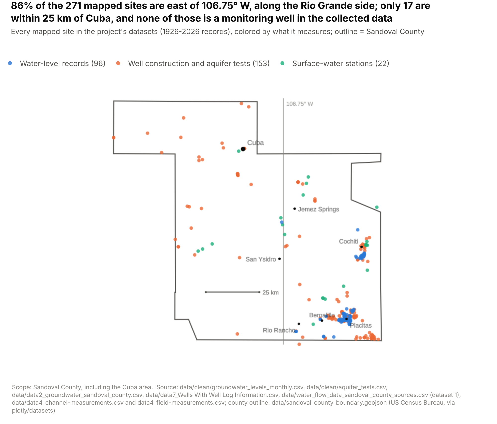

**Takeaway:** 86% of the 271 mapped sites are east of 106.75° W, along the Rio Grande side; only 17 are within 25 km of Cuba, and none of those is a monitoring well in the collected data.

| | |
|---|---|
| Research questions | 5, 1, 3 |
| What is plotted | Every mapped site in the project's datasets (1926-2026 records), colored by what it measures; outline = Sandoval County |
| Scope | Sandoval County, including the Cuba area |
| Data | data/clean/groundwater_levels_monthly.csv, data/clean/aquifer_tests.csv, data/data2_groundwater_sandoval_county.csv, data/data7_Wells With Well Log Information.csv, data/water_flow_data_sandoval_county_sources.csv (dataset 1), data/data4_channel-measurements.csv and data4_field-measurements.csv; county outline: data/sandoval_county_boundary.geojson (US Census Bureau, via plotly/datasets) |
| App page | County map |
| Code | `charts.county_coverage_map()` in `analysis/charts.py` |

**How to read it and method:** A dot is a site with any record in the collected files, not necessarily active monitoring: many are one-time tests from decades ago (hover for record years). Water-level records = USGS monitoring wells and NMBGMR wells; well construction and aquifer tests = OSE aquifer tests and well logs; surface-water stations = USGS stream, canal, and reservoir sites, including Rio Puerco at Cuba. The thin vertical line at 106.75° W is the east/west split used in the title. 3 sites lie just outside the simplified county line but are in the downloaded county files. One OSE well log isn't mapped because its coordinates disagree with its legal description. Town locations are approximate; in the app, zoom in to separate the dense Rio Grande cluster.

**Findings:**

- **Measured:** 271 mapped sites: 96 water-level records, 153 well construction and aquifer tests, 22 surface-water stations.
- **Measured:** Within 25 km of Cuba: 17 sites, none of them water-level monitoring sites; they are one-time aquifer tests or well logs and the Rio Puerco stream gage.
- **Insufficient data:** The northwest of the county, around Cuba, has no repeated groundwater-level record in the collected data.


### 2. groundwater_hydrographs

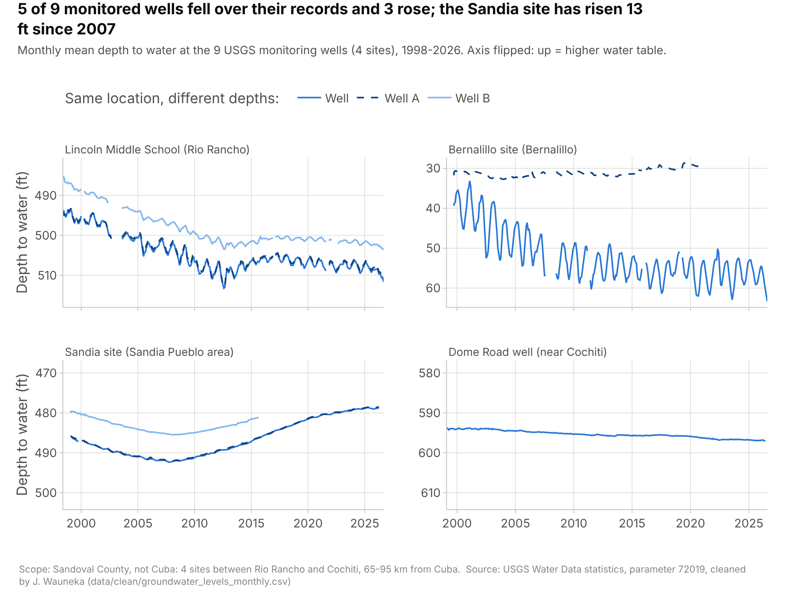

**Takeaway:** 5 of 9 monitored wells fell over their records and 3 rose; the Sandia site has risen 13 ft since 2007.

| | |
|---|---|
| Research questions | 1, 5, 6 |
| What is plotted | Monthly mean depth to water at the 9 USGS monitoring wells (4 sites), 1998-2026. Axis flipped: up = higher water table. |
| Scope | Sandoval County, not Cuba: 4 sites between Rio Rancho and Cochiti, 65-95 km from Cuba |
| Data | USGS Water Data statistics, parameter 72019, cleaned by J. Wauneka (data/clean/groundwater_levels_monthly.csv) |
| App page | Groundwater levels |
| Code | `charts.groundwater_hydrographs()` in `analysis/charts.py` |

**How to read it and method:** Each panel is one monitoring site. Wells marked A or B are at the same spot but measured at a different depth, so they are drawn separately; at Lincoln Middle School and the Sandia site, Well and Well A nearly coincide (Well A is dashed). Every panel spans the same 37 ft, so steepness can be compared across panels. Lines break where months are missing. These are water-level indicators at 4 sites, not measures of how much water is left.

**Findings:**

- **Measured:** Full-record trends (Mann-Kendall p < 0.05): falling: all 3 at Lincoln Middle School; Bernalillo site Well; Dome Road well; rising: Bernalillo site Well A; Sandia site Well, Sandia site Well A; 1 with no clear trend.
- **Measured:** At the Sandia site the water level fell until 2007, then rose about 13 ft by 2025.
- **Hypothesis:** The Sandia-site recovery after 2007 matches the timing of the San Juan-Chama Drinking Water Project (2008), after which the Albuquerque water utility pumped less groundwater; USGS mapped 30-40 ft rises across the Albuquerque area by 2016 (Ritchie et al. 2019, SIM 3435). These data alone can't show the cause.
- **Insufficient data:** None of these wells are near Cuba (65-95 km away), so they say nothing direct about Cuba's aquifer.


### 3. groundwater_trends

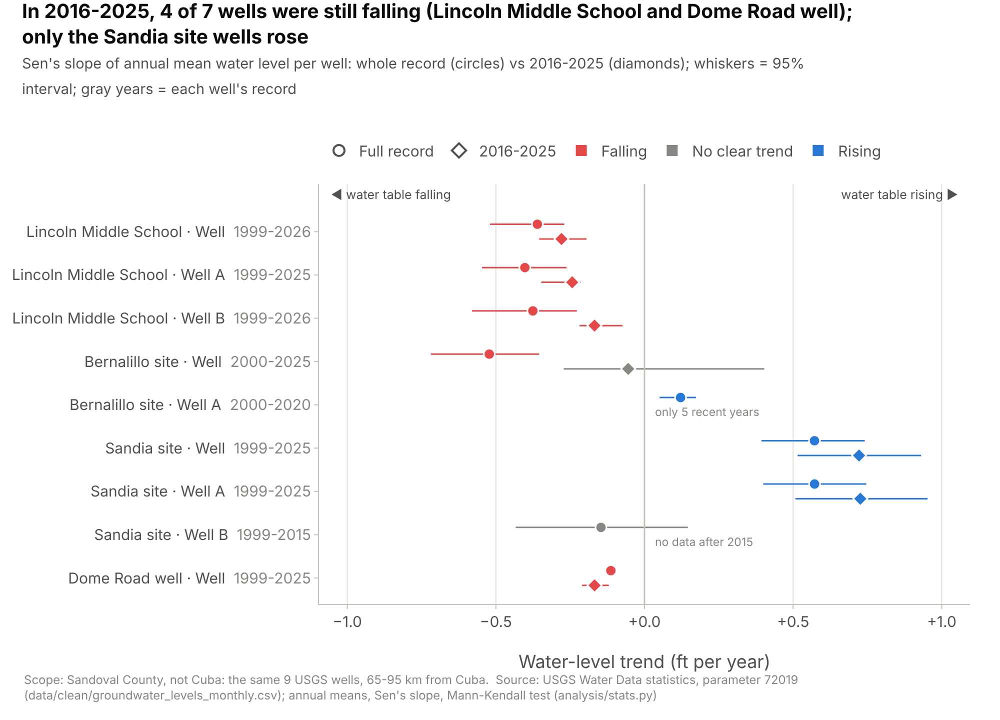

**Takeaway:** In 2016-2025, 4 of 7 wells were still falling (Lincoln Middle School and Dome Road well); only the Sandia site wells rose.

| | |
|---|---|
| Research questions | 1, 6 |
| What is plotted | Sen's slope of annual mean water level per well: whole record (circles) vs 2016-2025 (diamonds); whiskers = 95% interval; gray years = each well's record |
| Scope | Sandoval County, not Cuba: the same 9 USGS wells, 65-95 km from Cuba |
| Data | USGS Water Data statistics, parameter 72019 (data/clean/groundwater_levels_monthly.csv); annual means, Sen's slope, Mann-Kendall test (analysis/stats.py) |
| App page | Groundwater levels |
| Code | `charts.groundwater_trends()` in `analysis/charts.py` |

**How to read it and method:** Trend = Sen's slope of annual means (years with at least 9 months of data). Sen's slope assumes one direction, so a record that fell and then rose, like the Sandia site (see the hydrographs), gets one average slope. Color shows the Mann-Kendall test: red = falling, blue = rising, gray = no clear trend (p ≥ 0.05). Sign is flipped from depth so that negative = water table falling. Both the p-values and the intervals assume each year is independent; groundwater years aren't (a low year tends to follow a low year), so both look more certain than they are. Records differ in length (see the years by each well).

**Findings:**

- **Measured:** Full-record trends at Lincoln Middle School: -0.40 to -0.36 ft/yr (water table falling).
- **Measured:** Bernalillo site main well: -0.52 ft/yr over the full record, no clear trend in 2016-2025.
- **Measured:** Sandia site well: +0.57 ft/yr over the full record and +0.72 ft/yr in 2016-2025.


### 4. placitas_remeasured

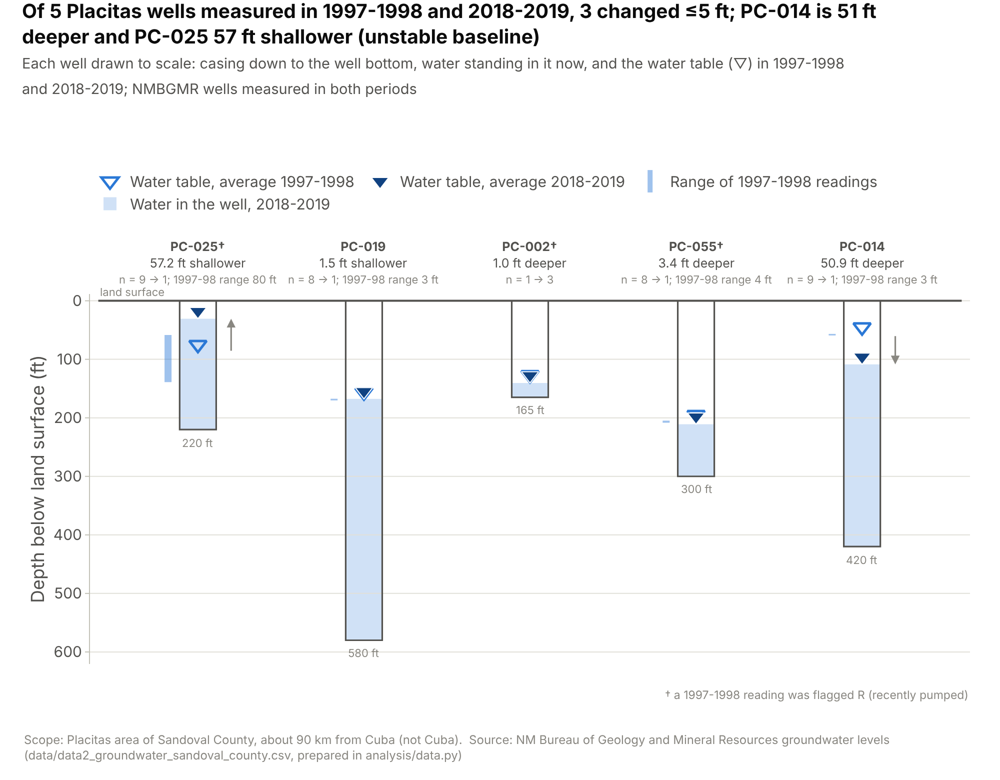

**Takeaway:** Of 5 Placitas wells measured in 1997-1998 and 2018-2019, 3 changed ≤5 ft; PC-014 is 51 ft deeper and PC-025 57 ft shallower (unstable baseline).

| | |
|---|---|
| Research questions | 1, 5 |
| What is plotted | Each well drawn to scale: casing down to the well bottom, water standing in it now, and the water table (▽) in 1997-1998 and 2018-2019; NMBGMR wells measured in both periods |
| Scope | Placitas area of Sandoval County, about 90 km from Cuba (not Cuba) |
| Data | NM Bureau of Geology and Mineral Resources groundwater levels (data/data2_groundwater_sandoval_county.csv, prepared in analysis/data.py) |
| App page | Groundwater levels |
| Code | `charts.placitas_remeasured()` in `analysis/charts.py` |

**How to read it and method:** The 1997-1998 readings were taken about every 63 days (median gap), so the shaded bar shows how much a well varied then; a change smaller than that range may just be seasonal. † = at least one 1997-1998 reading carries LevelStatus R (in USGS coding, 'recently pumped'), which can make the water level read deeper than normal. The measuring method also changed between periods (code T in 1997-1998, S/T in 2018-2019; T is electric tape and S steel tape in USGS coding). Wells measured in only one period (82 of 87) can't show change and are left out. The well drawings are cross-sections to vertical scale (casing width is not to scale); the blue fill is the water column above the well bottom at the 2018-2019 reading, a rough guide to how much drawdown a well can take, not a measure of the aquifer.

**Findings:**

- **Measured:** 3 of 5 re-measured wells are within 5 ft of their 1997-1998 average.
- **Measured:** PC-014 is 51 ft deeper than in 1997-1998 (well 420 ft deep; 1 recent reading).
- **Measured:** PC-025 is 57 ft shallower, but its 1997-1998 readings rose steadily by 80 ft after a first reading flagged R, so its 1997-1998 average is not a stable baseline.
- **Insufficient data:** 5 wells, mostly with a single recent reading, can't establish an area-wide trend.


### 5. well_depth_vs_water

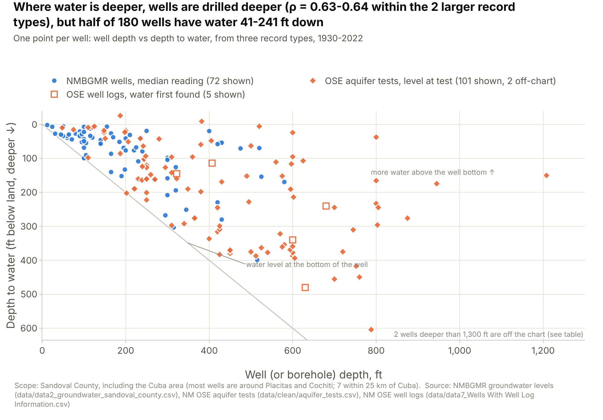

**Takeaway:** Where water is deeper, wells are drilled deeper (ρ = 0.63-0.64 within the 2 larger record types), but half of 180 wells have water 41-241 ft down.

| | |
|---|---|
| Research questions | 2 |
| What is plotted | One point per well: well depth vs depth to water, from three record types, 1930-2022 |
| Scope | Sandoval County, including the Cuba area (most wells are around Placitas and Cochiti; 7 within 25 km of Cuba) |
| Data | NMBGMR groundwater levels (data/data2_groundwater_sandoval_county.csv), NM OSE aquifer tests (data/clean/aquifer_tests.csv), NM OSE well logs (data/data7_Wells With Well Log Information.csv) |
| App page | Wells and aquifers |
| Code | `charts.well_depth_vs_water()` in `analysis/charts.py` |

**How to read it and method:** Points far above the diagonal have a lot of water standing above the well bottom; points near it have little. Colors follow the project's data types (blue = water-level records, orange = well construction and tests). The three sources measure water differently (a 1997-2019 measurement, the level on the day of an aquifer test, the depth where water was first hit while drilling), so treat them as context, not one comparable series. 1 record was left out because its water level is deeper than the well itself (RG-54556x: 30 ft well, water at 458 ft), likely a data-entry error.

**Findings:**

- **Measured:** Median depth to water by record type: NMBGMR wells 53 ft (n=72); OSE aquifer tests 165 ft (n=103); OSE well logs 240 ft (n=5).
- **Measured:** Spearman ρ between well depth and depth to water: NMBGMR wells 0.64; OSE aquifer tests 0.63 (all records pooled: 0.73, inflated because the record types differ in depth). Record types with fewer than 10 wells aren't tested.
- **Measured:** Median water column above the well bottom: 142 ft. 2 wells had water above land surface when tested (flowing artesian; plotted above 0).
- **Insufficient data:** Only the aquifer tests record the formation; the NMBGMR and well-log files don't, so this chart can't say which aquifer each well uses.


### 6. depth_by_area

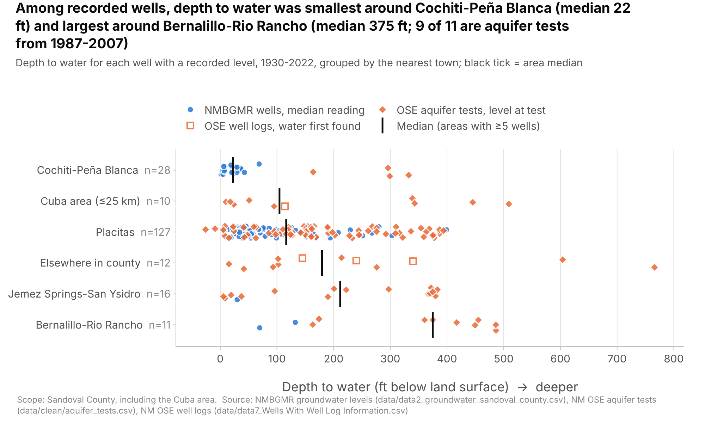

**Takeaway:** Among recorded wells, depth to water was smallest around Cochiti-Peña Blanca (median 22 ft) and largest around Bernalillo-Rio Rancho (median 375 ft; 9 of 11 are aquifer tests from 1987-2007).

| | |
|---|---|
| Research questions | 2, 3 |
| What is plotted | Depth to water for each well with a recorded level, 1930-2022, grouped by the nearest town; black tick = area median |
| Scope | Sandoval County, including the Cuba area |
| Data | NMBGMR groundwater levels (data/data2_groundwater_sandoval_county.csv), NM OSE aquifer tests (data/clean/aquifer_tests.csv), NM OSE well logs (data/data7_Wells With Well Log Information.csv) |
| App page | Wells and aquifers |
| Code | `charts.depth_by_area()` in `analysis/charts.py` |

**How to read it and method:** Areas are a simple screening grouping: each well goes to the nearest of seven towns within 20 km (25 km for Cuba, to match the project's Cuba area), otherwise 'Elsewhere in county'. They are not hydrogeologic regions. One point per well, including wells without a recorded well depth; medians are shown only where an area has at least 5 wells. 1 well without a usable location is left out.

**Findings:**

- **Measured:** Median depth to water by area (areas with ≥5 wells): Cochiti-Peña Blanca 22 ft; Cuba area (≤25 km) 104 ft; Placitas 116 ft; Elsewhere in county 180 ft; Jemez Springs-San Ysidro 212 ft; Bernalillo-Rio Rancho 375 ft.
- **Measured:** Cuba area: 10 wells with a recorded level, 10-509 ft to water, all recorded 1957-2018.
- **Insufficient data:** Areas mix record types and decades; differences may reflect different aquifers, land elevations, and dates, not just place.


### 7. formation_properties

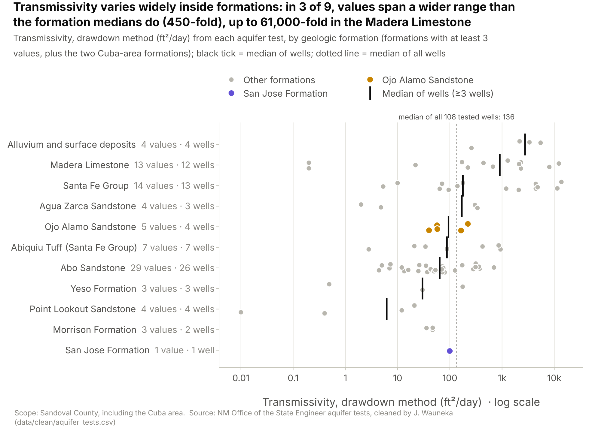

**Takeaway:** Transmissivity varies widely inside formations: in 3 of 9, values span a wider range than the formation medians do (450-fold), up to 61,000-fold in the Madera Limestone.

| | |
|---|---|
| Research questions | 2, 4 |
| What is plotted | Transmissivity, drawdown method (ft²/day) from each aquifer test, by geologic formation (formations with at least 3 values, plus the two Cuba-area formations); black tick = median of wells; dotted line = median of all wells |
| Scope | Sandoval County, including the Cuba area |
| Data | NM Office of the State Engineer aquifer tests, cleaned by J. Wauneka (data/clean/aquifer_tests.csv) |
| App page | Wells and aquifers |
| Code | `charts.formation_properties()` in `analysis/charts.py` |

**How to read it and method:** Transmissivity is how easily water moves through the full thickness of the aquifer; higher means a more productive aquifer. Each dot is one reported value; a well tested more than once (or reported on two rows for the same day) has more than one dot, so the gray label counts values and wells. Medians are taken per well first, so a well tested twice counts once, and are drawn only for formations with at least 3 tested wells. Wells without a recorded formation (22 of the 108 wells with a value) count only in the all-wells median. Tests span 1930-2008.

**Findings:**

- **Measured:** Median of all 108 tested wells with a value: 136 ft²/day (middle half 27.5-988; 22 wells have no recorded formation).
- **Measured:** Among formations with ≥3 tested wells, the highest median is Alluvium and surface deposits (2,760 ft²/day) and the lowest is Point Lookout Sandstone (6.2 ft²/day).
- **Measured:** Ojo Alamo: median of 4 wells 94.2 ft²/day, inside the middle half of all tested wells (27.5-988); with 4 wells, too few to say it differs.
- **Insufficient data:** Most formations have fewer than 10 tested wells, many tested in the 1970s; a single new test can move a median a lot.


### 8. cuba_area_map

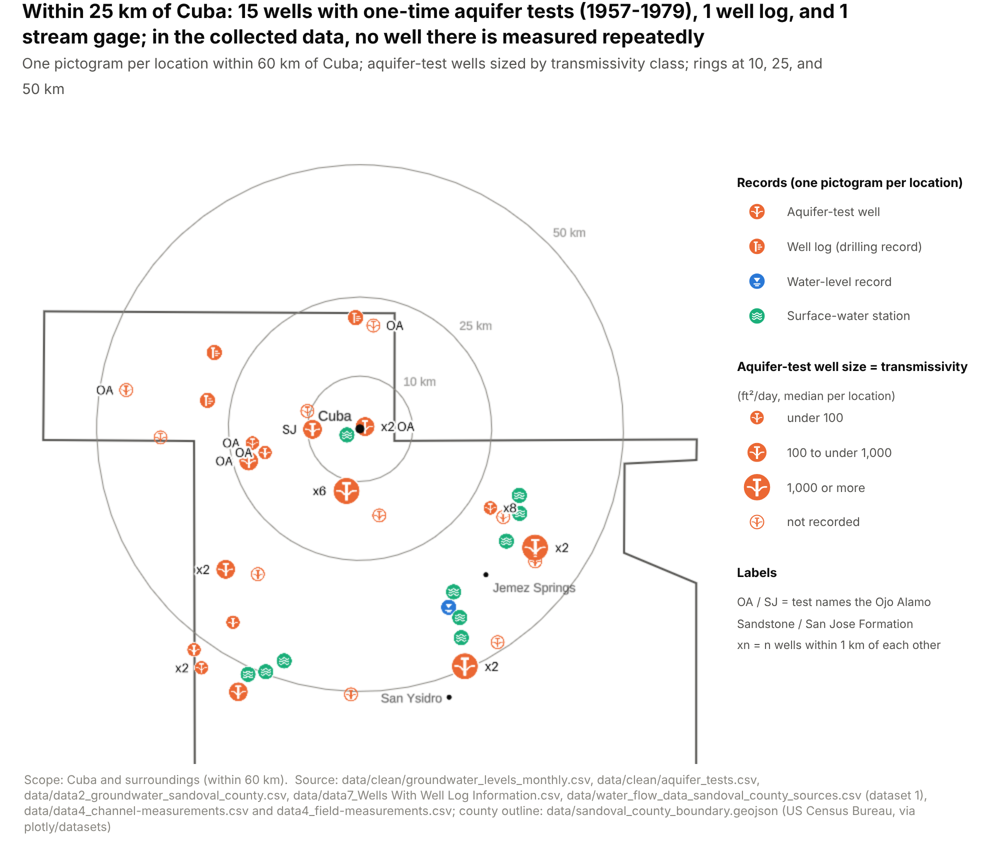

**Takeaway:** Within 25 km of Cuba: 15 wells with one-time aquifer tests (1957-1979), 1 well log, and 1 stream gage; in the collected data, no well there is measured repeatedly.

| | |
|---|---|
| Research questions | 3, 5 |
| What is plotted | One pictogram per location within 60 km of Cuba; aquifer-test wells sized by transmissivity class; rings at 10, 25, and 50 km |
| Scope | Cuba and surroundings (within 60 km) |
| Data | data/clean/groundwater_levels_monthly.csv, data/clean/aquifer_tests.csv, data/data2_groundwater_sandoval_county.csv, data/data7_Wells With Well Log Information.csv, data/water_flow_data_sandoval_county_sources.csv (dataset 1), data/data4_channel-measurements.csv and data4_field-measurements.csv; county outline: data/sandoval_county_boundary.geojson (US Census Bureau, via plotly/datasets) |
| App page | Cuba case study |
| Code | `charts.cuba_area_map()` in `analysis/charts.py` |

**How to read it and method:** Most sites near Cuba are aquifer tests done once, decades ago; they give well depth, aquifer properties, and the water level on test day, not a trend. The Rio Puerco gage measures the river, not groundwater. The 25 km 'Cuba area' radius is an analysis choice, not an official boundary. Town locations are approximate. Pictogram size is a class of transmissivity (three classes, see the key), not a proportional scale; 27 of 41 tested wells on the map have a value (median of each well's tests; where wells share a location, the median of those wells). Transmissivity describes the aquifer at that well on test day, not today's supply. Pictograms are drawn far larger than a well, so they overlap; sites of one kind within 1 km of each other share one pictogram with a count (7 places), and overlapping pictograms are nudged at most 1 km and never across a distance ring. Pictograms scale with zoom in the app.

**Findings:**

- **Measured:** 9 of the tested wells within 25 km had a one-time depth to water recorded during their test (1957-1978), e.g. 18 ft at 0.7 km in 1957. Two of the well names may be the same well (same location and depth).
- **Measured:** Transmissivity was recorded at 11 of the 15 tested wells within 25 km: from 57 ft²/day (20.3W.8.424, 19 km) to 5,508 ft²/day (Prod Well No 1, 12 km); the 4 Ojo Alamo wells with a value measured 57-164 ft²/day. One-time tests, 1957-1979.
- **Measured:** The nearest well with repeated water-level measurements is 38 km away (WL-0062, 2 readings in 2017).
- **Insufficient data:** Without repeated water levels near Cuba, the data can't confirm or rule out severe decline in Cuba's aquifer (research question 3).


### 9. cuba_nearest_records

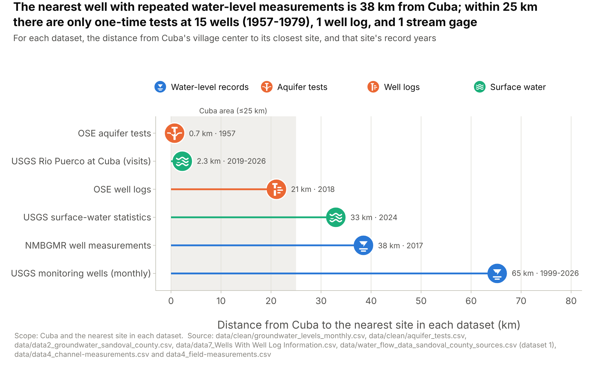

**Takeaway:** The nearest well with repeated water-level measurements is 38 km from Cuba; within 25 km there are only one-time tests at 15 wells (1957-1979), 1 well log, and 1 stream gage.

| | |
|---|---|
| Research questions | 3, 5 |
| What is plotted | For each dataset, the distance from Cuba's village center to its closest site, and that site's record years |
| Scope | Cuba and the nearest site in each dataset |
| Data | data/clean/groundwater_levels_monthly.csv, data/clean/aquifer_tests.csv, data/data2_groundwater_sandoval_county.csv, data/data7_Wells With Well Log Information.csv, data/water_flow_data_sandoval_county_sources.csv (dataset 1), data/data4_channel-measurements.csv and data4_field-measurements.csv |
| App page | Cuba case study |
| Code | `charts.cuba_nearest_records()` in `analysis/charts.py` |

**How to read it and method:** Distances are straight-line from the approximate village center. A short stem only means a site is close, not that it answers the question: the closest records are one-time aquifer tests and river visits, neither of which tracks groundwater over time. Pictograms: ▽ water-table symbol = water-level records; well with a cone of depression = aquifer test; well with a log strip = well log; waves = surface water.

**Findings:**

- **Measured:** Nearest repeated water-level record: WL-0062 (NMBGMR well measurements), 38 km, 2 readings in 2017; nearest USGS monitoring well: 65 km.
- **Measured:** Nearest aquifer test: 0.7 km (1957), a one-time record.
- **Insufficient data:** Answering research question 3 needs Cuba's municipal well records: well IDs, formation, pumping, and water-level history.


### 10. ojo_alamo_depth_map

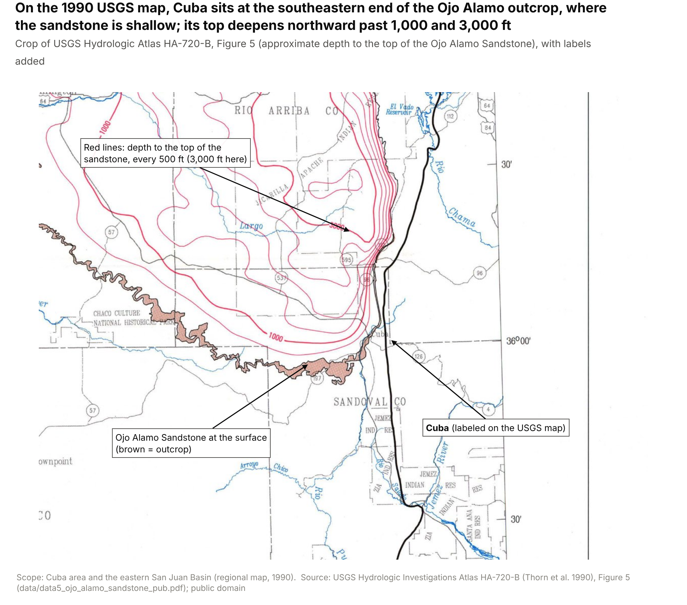

**Takeaway:** On the 1990 USGS map, Cuba sits at the southeastern end of the Ojo Alamo outcrop, where the sandstone is shallow; its top deepens northward past 1,000 and 3,000 ft.

| | |
|---|---|
| Research questions | 4, 2, 3 |
| What is plotted | Crop of USGS Hydrologic Atlas HA-720-B, Figure 5 (approximate depth to the top of the Ojo Alamo Sandstone), with labels added |
| Scope | Cuba area and the eastern San Juan Basin (regional map, 1990) |
| Data | USGS Hydrologic Investigations Atlas HA-720-B (Thorn et al. 1990), Figure 5 (data/data5_ojo_alamo_sandstone_pub.pdf); public domain |
| App page | Cuba case study |
| Code | `charts.ojo_alamo_depth_map()` in `analysis/charts.py` |

**How to read it and method:** The map itself is unchanged; only the white labels and arrows are added. Brown is where the Ojo Alamo Sandstone crops out at the surface; each red line joins points where its top is the same depth below land surface, every 500 ft. 'Cuba' is the map's own town label. Dataset 5 is a scanned plate, so values are read by eye and nothing here is digitized.

**Findings:**

- **Measured:** On the USGS map, Cuba sits at the southeastern end of the Ojo Alamo outcrop band, where the top of the sandstone is shallow; it deepens northward along the basin's eastern edge, past the 1,000-ft and 3,000-ft lines (read from the published map).
- **Hypothesis:** Because the Ojo Alamo is shallow at Cuba, shallow wells there can reach it, as the 148-ft Cuba school well did in 1957; whether Cuba's municipal wells use it today isn't established.
- **Insufficient data:** This is a 1990 regional interpretation at 1:1,000,000 scale, read by eye; it doesn't show current water levels, how much water the formation holds, or which formation Cuba's wells use.


### 11. ojo_alamo_vs_san_jose

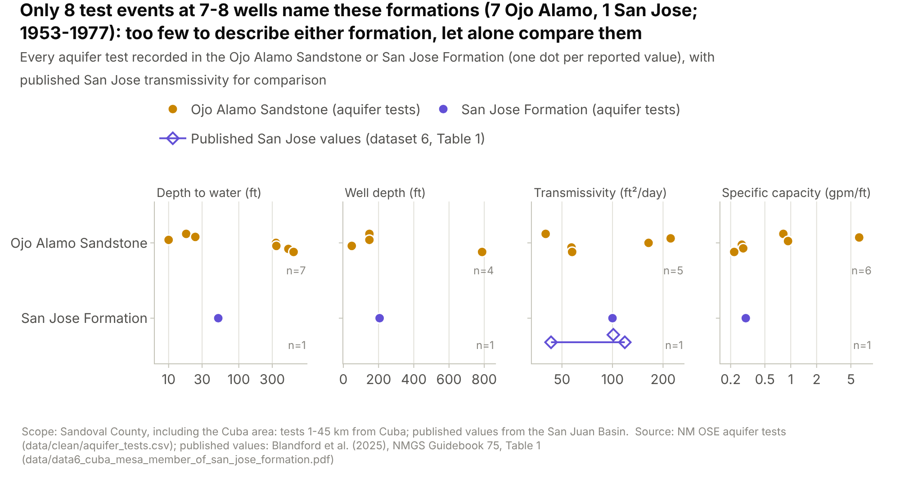

**Takeaway:** Only 8 test events at 7-8 wells name these formations (7 Ojo Alamo, 1 San Jose; 1953-1977): too few to describe either formation, let alone compare them.

| | |
|---|---|
| Research questions | 4, 2 |
| What is plotted | Every aquifer test recorded in the Ojo Alamo Sandstone or San Jose Formation (one dot per reported value), with published San Jose transmissivity for comparison |
| Scope | Sandoval County, including the Cuba area: tests 1-45 km from Cuba; published values from the San Juan Basin |
| Data | NM OSE aquifer tests (data/clean/aquifer_tests.csv); published values: Blandford et al. (2025), NMGS Guidebook 75, Table 1 (data/data6_cuba_mesa_member_of_san_jose_formation.pdf) |
| App page | Cuba case study |
| Code | `charts.ojo_alamo_vs_san_jose()` in `analysis/charts.py` |

**How to read it and method:** A test event is one well on one date; some events are reported on two rows (e.g. separate drawdown results), so n counts values. Two Ojo Alamo well names, 'Cuba Independent Rural School Well No 1' and '21.1W.28.143', share a location and depth and may be the same well. Open violet diamonds are published San Jose Formation transmissivity compiled in Blandford et al. (2025, Table 1): well SJ-2259, screened in the Cuba Mesa Member near Lindrith (estimated from specific capacity, assuming 70% well efficiency), and a range from two tests in Stone et al. (1983), location not given; both converted from m²/day. A value entered twice for the same test is drawn once. Depth to water and the two right panels use log scales. Blank panels mean the value wasn't recorded. The tests date from 1953-1977 and don't show which formation Cuba's municipal wells use today.

**Findings:**

- **Measured:** Ojo Alamo depth to water: 18-24 ft at the well(s) within 5 km of Cuba, and 10-604 ft at wells 19-45 km away.
- **Measured:** San Jose: one test at one well (BIA-(RF)-033-2(10) Smelser Well, 9 km from Cuba, 1977): 51 ft to water, 206 ft deep, 100 ft²/day. That is close to the one published Cuba Mesa Member value near Lindrith (101 ft²/day at well SJ-2259, estimated from specific capacity) and inside the San Jose range from Stone et al. (1983), 43-118 ft²/day.
- **Insufficient data:** Comparing the formations needs more (and recent) tests, plus the Ojo Alamo thickness and extent maps in USGS HA-720-B (dataset 5), which is a scanned map plate not yet digitized.


### 12. rio_puerco_visits

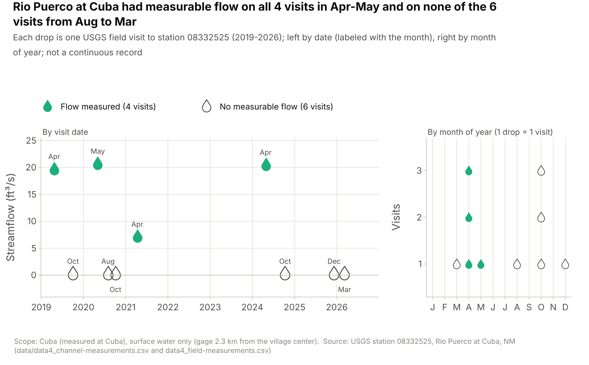

**Takeaway:** Rio Puerco at Cuba had measurable flow on all 4 visits in Apr-May and on none of the 6 visits from Aug to Mar.

| | |
|---|---|
| Research questions | 3, 5, 6 |
| What is plotted | Each drop is one USGS field visit to station 08332525 (2019-2026); left by date (labeled with the month), right by month of year; not a continuous record |
| Scope | Cuba (measured at Cuba), surface water only (gage 2.3 km from the village center) |
| Data | USGS station 08332525, Rio Puerco at Cuba, NM (data/data4_channel-measurements.csv and data4_field-measurements.csv) |
| App page | Cuba case study |
| Code | `charts.rio_puerco_visits()` in `analysis/charts.py` |

**How to read it and method:** No line is drawn between visits because the river was not measured in between. 'No measurable flow' is what the visit recorded at that moment (the channel may still hold pools), not that the river was dry all season. This station measures the river at Cuba, not Cuba's groundwater or water supply.

**Findings:**

- **Measured:** 6 of 10 visits (2019-2026) found no measurable flow; flowing visits measured 6.89-20.4 ft³/s, all in Apr or May.
- **Hypothesis:** Flow at Cuba may depend mostly on spring snowmelt from the mountains upstream; ten visits are consistent with that but can't prove it.
- **Insufficient data:** Spot visits can't show how many days a year the river has no flow, or any long-term trend.


### 13. coverage_timeline

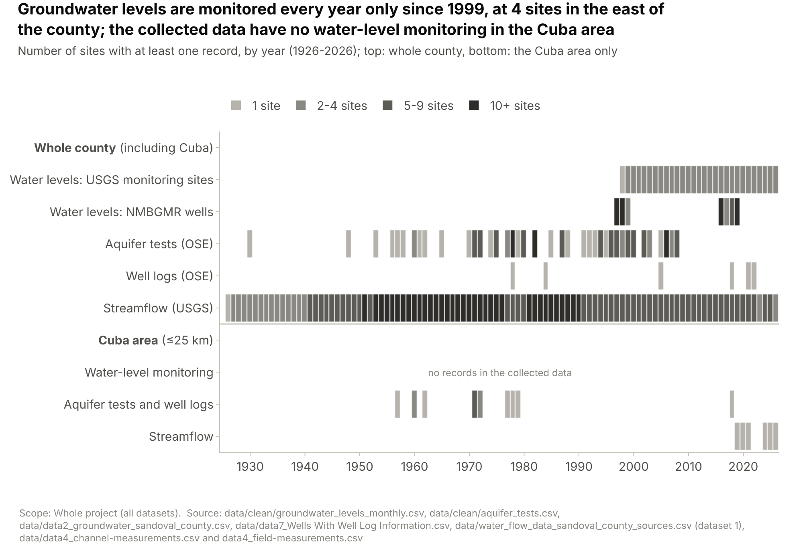

**Takeaway:** Groundwater levels are monitored every year only since 1999, at 4 sites in the east of the county; the collected data have no water-level monitoring in the Cuba area.

| | |
|---|---|
| Research questions | 5, 6 |
| What is plotted | Number of sites with at least one record, by year (1926-2026); top: whole county, bottom: the Cuba area only |
| Scope | Whole project (all datasets) |
| Data | data/clean/groundwater_levels_monthly.csv, data/clean/aquifer_tests.csv, data/data2_groundwater_sandoval_county.csv, data/data7_Wells With Well Log Information.csv, data/water_flow_data_sandoval_county_sources.csv (dataset 1), data/data4_channel-measurements.csv and data4_field-measurements.csv |
| App page | Data sources |
| Code | `charts.coverage_timeline()` in `analysis/charts.py` |

**How to read it and method:** Darker = more sites recorded that year. The USGS row counts monitoring sites (locations; the 9 wells sit at 4 sites). Aquifer tests count wells tested that year (each test also records a one-time water level, which isn't monitoring). Streamflow includes the Rio Puerco at Cuba visits. Gaps are years with no record in these files; other agencies may have data.

**Findings:**

- **Measured:** USGS monitoring sites cover 1998-2026 (all 4 from 1999); NMBGMR wells were measured in 1997-1999 and 2016-2019, with nothing in between.
- **Measured:** Cuba-area well records come from 9 separate years (1957-2018); the only recent Cuba-area data are Rio Puerco visits (2019-2026).
- **Insufficient data:** No repeated groundwater-level records exist for the Cuba area in the collected data.


### 14. evidence_matrix

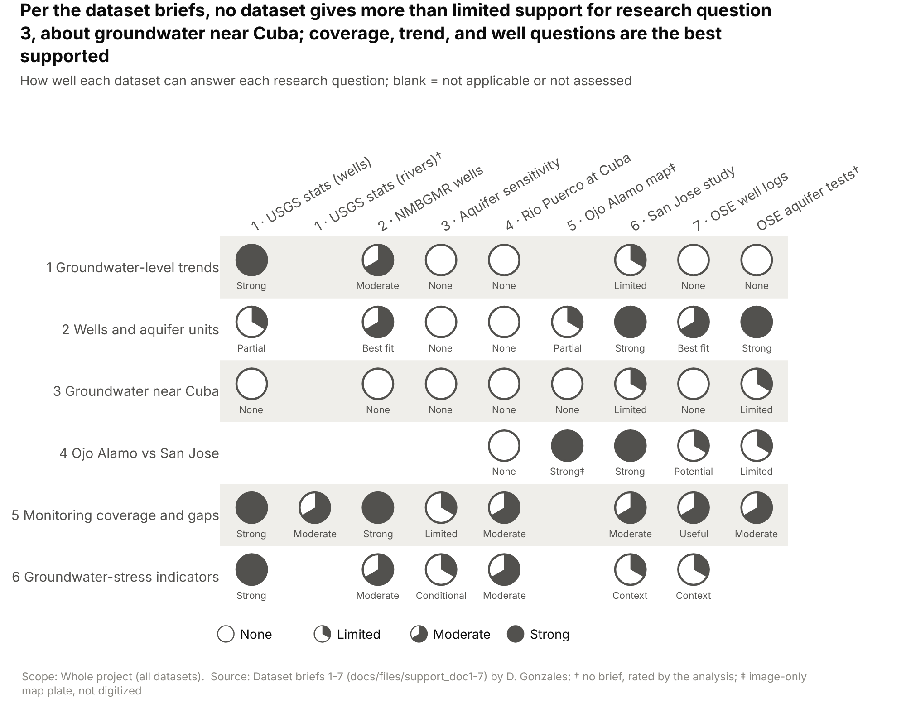

**Takeaway:** Per the dataset briefs, no dataset gives more than limited support for research question 3, about groundwater near Cuba; coverage, trend, and well questions are the best supported.

| | |
|---|---|
| Research questions | 5, 6 |
| What is plotted | How well each dataset can answer each research question; blank = not applicable or not assessed |
| Scope | Whole project (all datasets) |
| Data | Dataset briefs 1-7 (docs/files/support_doc1-7) by D. Gonzales; † no brief, rated by the analysis; ‡ image-only map plate, not digitized |
| App page | Data sources |
| Code | `charts.evidence_matrix()` in `analysis/charts.py` |

**How to read it and method:** Ratings come from Dylan's one-page dataset briefs; each cell shows a short form of the brief's wording (e.g. 'Best fit' for 'Strongest fit (partial)'), grouped into four Harvey balls (empty, one third, two thirds, full): None = None; Limited = Limited, Partial, Potential, Conditional, Context; Moderate = Moderate, Best fit, Useful; Strong = Strong. The briefs rated the proposal's nine questions; their ratings are shown under the team's six (questions 1-4 unchanged, 8 → 5, 9 → 6; the three dropped questions are left out). † = no brief; rated by the analysis (the river part of USGS dataset 1 and the OSE aquifer tests). ‡ = an image-only map plate: it is shown as an attributed map on the Cuba page but not digitized, so its numbers aren't charted, and its 'Strong' for question 4 holds only once it is digitized. This is a judgment summary of what each dataset could support, not a measurement.

**Findings:**

- **Insufficient data:** No dataset is rated moderate or strong for question 3 (Groundwater near Cuba).
- **Insufficient data:** Question 3 needs Cuba's municipal well records, which weren't collected.


### 15. aquifer_sensitivity_classes

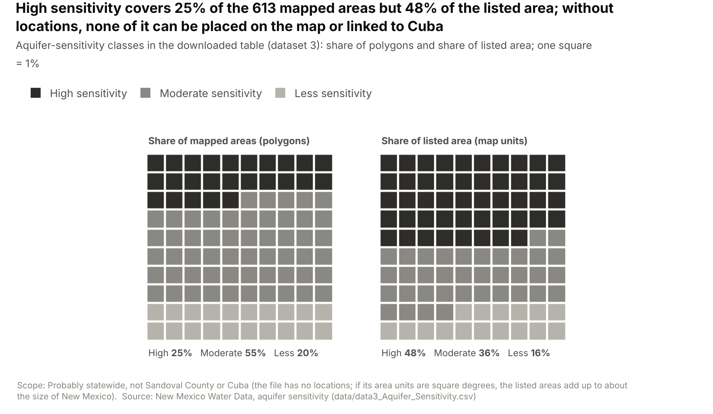

**Takeaway:** High sensitivity covers 25% of the 613 mapped areas but 48% of the listed area; without locations, none of it can be placed on the map or linked to Cuba.

| | |
|---|---|
| Research questions | 5, 6 |
| What is plotted | Aquifer-sensitivity classes in the downloaded table (dataset 3): share of polygons and share of listed area; one square = 1% |
| Scope | Probably statewide, not Sandoval County or Cuba (the file has no locations; if its area units are square degrees, the listed areas add up to about the size of New Mexico) |
| Data | New Mexico Water Data, aquifer sensitivity (data/data3_Aquifer_Sensitivity.csv) |
| App page | Data sources |
| Code | `charts.aquifer_sensitivity_classes()` in `analysis/charts.py` |

**How to read it and method:** Area shares use the table's Shape__Area column, whose units aren't stated (they appear to be square degrees, which shrink slightly northward), so the shares are approximate. Polygon counts and area shares differ because a few large polygons dominate. This describes the downloaded inventory, not Cuba. Squares are rounded to whole percents so each grid adds up to 100.

**Findings:**

- **Measured:** 613 polygons: High 152, Moderate 339, Less 122; share of listed area: High 48%, Moderate 36%, Less 16%.
- **Insufficient data:** The CSV has no coordinates, and what 'sensitivity' measures isn't documented in it; the map layer and its metadata weren't collected (a coverage gap, research question 5).

<!-- END GENERATED: chart sections -->

## Limitations

- **Almost nothing measures Cuba's groundwater.** The nearest well measured more than once is about 38 km away. The answer to research question 3 is "insufficient data" until Cuba's municipal well records are collected.
- **Four monitoring sites carry the county's trend story,** all between Rio Rancho and Cochiti. They are indicators at those points, not a county average or a measure of how much water is left.
- **Old, one-time records.** Most aquifer tests date from 1930 to 2008 and record conditions on test day.
- **Three proposal questions were dropped for lack of data:** groundwater quality, acequias, and links between groundwater and surface water (see [Not collected](data-collection.md#not-collected)). No geologic-region layer was collected either, so wells are grouped by nearest town and by the formation named in their aquifer tests.
- **Simple statistics.** Trends and correlations assume independent years; with serial correlation they look more certain than they are. Results are screening-level, not a groundwater model.

## How the charts were reviewed

Because the course didn't provide a chart rubric, the analysis wrote one from the project's own rules (the proposal, Dylan's plotting guide and briefs, James's conventions) plus standard data-visualization practice: [`analysis/review/RUBRIC.md`](https://github.com/pdjordj11/eng_220_aquifer_project/blob/main/analysis/review/RUBRIC.md). An independent reviewer graded every chart against it, the charts were fixed, and the cycle repeated. A final single review pass checked the pictograph versions. The full reports and the score history are in [`analysis/review/`](https://github.com/pdjordj11/eng_220_aquifer_project/tree/main/analysis/review).
